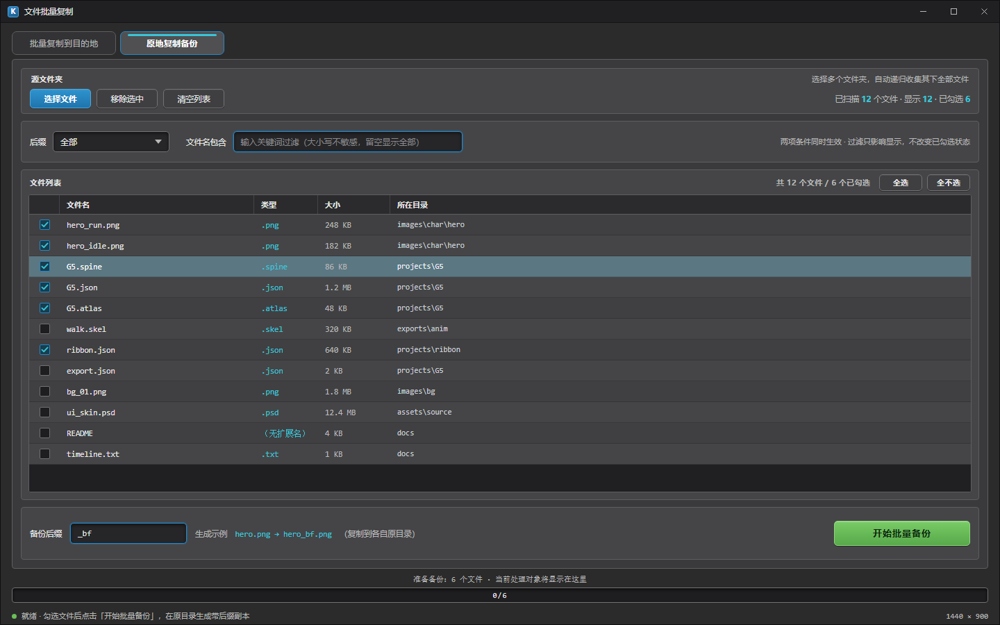

# 「原地复制备份」功能设计说明书（R2 安全加固版 / 已施工）

> 关联需求：在「文件批量复制」窗口增加第二个标签页「原地复制备份」。
> 设计阶段交付：**本文档 + 渲染图 `mockup.png` + 渲染源 `mockup.html` + 独立审核报告 `review.md`**。
> **状态：2026-11-09 用户明确批准「开始施工」，已按第 8 节清单完成实现，通过编译、安全静态审查与 40 项真实磁盘验证。施工记录与实现差异见第 12 节；第 10 节为施工前的边界声明（历史记录）。**

## 安全红线（用户 2026-11-09 明确给出，优先级高于本文所有其它条款）

> **新功能只能是批量本地复制；必须带后缀；不能删改源文件；不能覆盖源文件；不能对源文件做任何额外操作。**

这 5 条已在本文第 **6.6 节「安全不变式」** 固化为 8 条不可绕过的技术约束。第 9 节中与红线冲突的选项已冻结，不再作为可协商项。任何实现若无法满足 6.6，视为施工失败，不得交付。

## 术语定义（消除「源文件」歧义）

| 术语 | 本文含义 |
| --- | --- |
| **源文件** | 用户勾选、要被备份的**用户文件**（如 `hero.png`）。安全红线中的「源文件」专指此类；与第 8 节施工清单里的 `.cs` 代码文件无关 |
| **目标 / 备份产物** | 由 6.2 公式生成的 `{原文件名}{后缀}{原扩展名}`，恒在源文件原目录 |
| **占用** | 目标路径上已存在任何文件、目录、硬链接或重解析点 |
| **列表数据** | 内存中的 `List<BackupFileEntry>` 与 UI 列表项，**不是磁盘文件** |

| 项目 | 内容 |
| --- | --- |
| 文档状态 | R2 已完成独立审核与加固；已批准并施工完成 |
| 当前阶段 | 1 / 3：设计文档 ✅ → 2 / 3：渲染图 ✅ → 3 / 3：施工与自检 ✅ |
| 施工范围 | 严格以第 10 节「施工边界声明」为准，超范围改动需再次确认 |
| 视觉基准 | `docs/ui-refactor/style-guide.md`、`mockups/00-style-board.png`、`mockups/06-batch-copy.png`、`mockups/16-subfolder-select.png` |
| 代码基准 | `KeyMacro/Forms/BatchCopyWindow.cs`、`BatchCliWindow.cs`、`KeyMacro/Controls/DarkTabControl.cs`、`KeyMacro/Services/UiTheme.cs` |
| 审核记录 | `docs/inplace-backup/review.md`（4 项阻断级 / 7 项高 / 5 项中 / 3 项低，均已处置） |

---

## 0. 渲染图（供审查）



> 1440×900 高保真静态渲染图，为便于审查选中了第二个 Tab。可直接在浏览器打开同源文件 `mockup.html` 查看可缩放版本。
> 图为**设计方向**，不代表当前软件已实现；渲染图只指导布局与视觉，按钮文字、事件绑定与功能语义以本文及现有代码为准。
> **R2 说明**：安全加固未改变主页面控件与布局，本图仍然有效；因为采取「目标已存在一律自动跳过」而非弹窗决策，**不新增任何弹窗或按钮**，预检结果只在状态栏文字与完成汇总中体现（状态栏控件本就存在）。

| 图区 | 对应本文 | 说明 |
| --- | --- | --- |
| 顶部两枚胶囊页签 | 第 3 节 | 复用 `DarkTabControl`；实际默认选中 Tab1，图中为审查需要选中 Tab2 |
| A 源文件夹工具栏 | 4.1 | 「选择文件 / 移除选中 / 清空列表」与 Tab1 同款同序，右侧三项计数；**三者只操作内存列表，零磁盘写入** |
| B 显示门槛 | 4.2 | 后缀下拉（默认 `全部`）+ 关键词输入框，两项为 AND |
| C 文件列表 | 4.3 | 逐行勾选框 + 全选 / 全不选 + 五列（含「所在目录」区分同名文件） |
| D 备份设置 | 4.4 / 4.5 | 默认 `_bf`、实时命名示例、绿色主操作「开始批量备份」 |
| 底部进度 + 状态栏 | 第 3 节 / 4.5 | 窗口级共享；状态栏实时显示「N 个目标已存在，将自动跳过」 |

---

## 1. 背景、目标与非目标

### 1.1 现状（症状）

`BatchCopyWindow` 目前只有一个工作区：源列表 → 三段式目标路径 → 复制到**别的目的目录**。动画师想在改文件前留一份「同目录副本」时，只能手工 `Ctrl+C / Ctrl+V` 再改名，或绕道用现有页面把文件复制回原目录（但现有页面不改文件名，会立刻同名冲突）。缺少「按规则在原地生成一批带后缀副本」的能力。

### 1.2 目标

| 编号 | 目标 |
| --- | --- |
| G1 | 窗口改为双标签：「批量复制到目的地」（原页面原样保留）/「原地复制备份」（新页面） |
| G2 | 新页支持一次选择**多个文件夹**，递归收集其下所有文件（只读扫描） |
| G3 | 新页提供两道显示门槛：后缀下拉（自动识别 + 「全部」）+ 自由输入关键词过滤 |
| G4 | 文件列表逐行勾选框 + 「全选」「全不选」 |
| G5 | 自定义备份后缀（默认 `_bf`），一键把勾选项复制为**同目录** `{原文件名}{后缀}{原扩展名}`；**绝不覆盖任何已存在文件** |
| G6 | 沿用原项目的深色工作台美术、进度条、取消机制与日志位置；**不沿用**其「覆盖 / 创建目录 / 默认 Overwrite」语义 |

### 1.3 非目标（本轮明确不做）

- **不改动**「批量复制到目的地」页的任何控件、文案、事件与业务逻辑（原样迁入 Tab1）。
- 不改主窗口工具栏入口（仍是「批量复制」一个按钮，窗口标题仍是「文件批量复制」）。
- 不做压缩包 / 时间戳版本号 / 云端备份 / 增量比对 / 还原回滚 / 自动追加序号改名。
- **不做任何覆盖**：不提供「覆盖」按钮、不传 `overwrite:true`、不复用 `ConflictAction.Overwrite`。
- **不做任何删除 / 移动 / 重命名 / 属性修改 / 时间戳修改**，包括失败清理与取消回滚。
- **不在源文件所在目录创建任何目录、日志、清单或临时文件**；日志只写 `%APPDATA%\KeyMacro\logs\`。
- 不改动 `config.json` 既有结构，不改动 `.kmp` 导入导出结构。
- 不自定义系统 `OpenFileDialog` / `FolderBrowserDialog` 外观（沿用项目的自绘勾选弹窗路线）。
- 不改动 `VirtualKeyWindow`、SKIN 资源与 VK 布局算法。

---

## 2. 现状代码依据（参考原项目，逐项对齐）

| 现有文件 / 资源 | 作用 | 本次关系 |
| --- | --- | --- |
| `KeyMacro/Forms/BatchCopyWindow.cs` | 单页批量复制窗口，`ClientSize 1440×900`、`Min 1040×680`、`UiTheme.Apply(this, BatchCopy)` | **改造**：外层换为 Tab 容器，原 UI 整体移入 Tab1 |
| `KeyMacro/Forms/BatchCliWindow.cs` | 现成的 `DarkTabControl` 双 Tab + 窗口级共享进度区范例 | **结构参考**：照搬「顶部 Tab / 内容 / 底部进度」三段式 |
| `KeyMacro/Controls/DarkTabControl.cs` | 圆角胶囊页签：选中 `PanelAlt` 底 + 蓝边 + 顶部青色强调线，`ItemSize 118×36` | **直接复用**，不另造页签控件 |
| `KeyMacro/Services/UiTheme.cs` | 全局配色、`ButtonKind` 按钮状态图、勾选框 / `CheckedListBox` / `ListView` / 列表行绘制 | **直接复用**；必要时仅追加一个 `UiWindowProfile` 枚举值（详见 4.3 风险注） |
| `KeyMacro/Services/BatchCopyService.cs` | `IsRunning` / `Cancel()` / `ProgressChanged` / `ProgressReported` / `Completed` / `ErrorOccurred` 事件签名 | **仅参考事件签名**。⛔ **禁止照抄其复制语义**（`:41` `Directory.CreateDirectory`、`:55` 默认 `Overwrite`、`:87` `overwrite:true`、`:91-95` 异常后仅 `done++` 无失败明细） |
| `KeyMacro/Forms/ConflictDialog.cs` | 同名冲突弹窗，含「覆盖」按钮且默认 `Overwrite` | ⛔ **不复用**。Tab2 不提供覆盖选项，改用「预检 → 自动跳过」；Tab1 保持原样不动 |
| `KeyMacro/Forms/SubfolderSelectDialog.cs` | 深灰 `DarkCheckedListBox` 勾选弹窗 + 全选 / 全不选 + 搜索 / 不包含框 | 多选文件夹弹窗的**视觉与交互参考** |
| `KeyMacro/Forms/SourceFilePicker.cs` | 现有「选择文件」缩略图勾选弹窗 | **Tab1 原样保留**；Tab2 不使用（Tab2 选的是文件夹） |
| `KeyMacro/assets/ui/checks/checkbox_*.png` | 勾选框三态图 | 列表勾选框资源 |
| `KeyMacro/assets/ui/buttons/button_{kind}_{state}.png` | 按钮五态图 | 工具栏、主操作按钮资源 |
| `KeyMacro/Services/OperationLogger.cs` | `Info / Warn / Error`，日志只写 `%APPDATA%\KeyMacro\logs\yyyy-MM-dd.log` | 扫描 / 复制 / 跳过 / 失败 / 取消均记日志；⛔ 禁止在源目录落任何日志文件 |
| `docs/ui-refactor/style-guide.md` | 色值、字阶、间距、控件规范 | 渲染图与施工的唯一美术基准 |

---

## 3. 信息架构

窗口整体三段式（与 `BatchCliWindow` 一致），**进度区在 TabControl 之外，由两个 Tab 共用**：

```
┌─ 文件批量复制 ────────────────────────────────────────────────┐
│ [批量复制到目的地] [原地复制备份]        ← DarkTabControl      │
│ ┌───────────────────────────────────────────────────────────┐ │
│ │  TabPage 内容区（两页各自独立，切换不丢状态）             │ │
│ │  Tab1：源文件 / 目标路径 / 预览目标 / 开始复制  ← 原样    │ │
│ │  Tab2：选择文件夹 / 过滤 / 勾选列表 / 备份后缀 / 执行     │ │
│ └───────────────────────────────────────────────────────────┘ │
│ 当前处理对象文字（进度条上方）                                 │
│ ████████████████░░░░░░░░░░  7/12   ← TextProgressBar        │
│ 就绪 · N 个目标已存在，将自动跳过             ← 状态标签       │
└───────────────────────────────────────────────────────────────┘
```

| 约定 | 取值 |
| --- | --- |
| 窗口标题 | 保持「文件批量复制」不变 |
| 默认选中页 | **Tab1**（不改变现有使用习惯，切页不重置任何一页的数据） |
| Tab 文案 | ① `批量复制到目的地` ② `原地复制备份` |
| 进度区 | 窗口级共享；两页各自执行时都写同一条状态栏 / 进度条 |
| **窗口级单任务互斥** | 任一批量任务运行期间：另一页主按钮禁用、**禁止切换 Tab**、窗口级保留可见的取消入口；避免两个异步任务并发写同一进度区或让用户无法取消 |
| **关闭保护** | 任务运行中关闭窗口：先 `Cancel()` 并等待任务结束再关闭；所有事件回调先判 `IsDisposed` |
| 窗口尺寸 | 沿用 `UiWindowProfile.BatchCopy`：`1440×900`，最小 `1040×680` |

---

## 4. Tab2「原地复制备份」控件清单

页面自上而下 5 个区域，尺寸沿用 `style-guide`：面板内边距 8–12、工具栏 32–36、标准按钮 28–32、主操作按钮 34–38。

### 4.1 A 区｜源工具栏

| 控件 | 类型 | 文案 / 默认 | 行为 | 视觉 |
| --- | --- | --- | --- | --- |
| `选择文件` | Button | — | 打开多文件夹选择弹窗（见 4.6），只读浏览 | `button_tool_*`（蓝绿工具态，与 Tab1 一致） |
| `移除选中` | Button | — | **仅从内存列表移除**当前高亮选中行（详见 9.1）；⛔ 零磁盘 I/O，不删除任何文件 | `button_neutral_*` |
| `清空列表` | Button | — | **仅清空内存列表数据**、勾选态、后缀下拉；备份后缀输入框不重置；⛔ 零磁盘 I/O | `button_neutral_*` |
| 计数标签 | Label | `已扫描 0 个文件 / 显示 0 / 已勾选 0` | 随扫描、过滤、勾选实时更新 | `Text.Secondary`，右对齐 |

> 三个按钮的文字、顺序、最小尺寸与 Tab1 顶部工具栏保持一致，保证两页视觉连续。
> **R2 强制措辞**：本节所有「移除 / 清空」只作用于术语表定义的**列表数据**，任何实现不得调用 `File.Delete` / `Directory.Delete` / `File.Move`。

### 4.2 B 区｜显示门槛（过滤条）

| 控件 | 类型 | 默认 | 行为 |
| --- | --- | --- | --- |
| 标签「后缀」 | Label | — | — |
| 后缀下拉 | ComboBox（`DropDownList`） | `全部` | 扫描完成后自动收集**去重、小写化、按字母排序**的扩展名，首项恒为 `全部`；选中即生效 |
| 标签「文件名包含」 | Label | — | — |
| 关键词输入 | TextBox | 空 | 300ms 防抖（沿用 Tab1 `_previewDebounce` 模式），大小写不敏感的子串匹配，仅匹配文件名 |
| `全选` | Button | — | 勾选**当前可见（过滤后）**的全部行 |
| `全不选` | Button | — | 取消勾选**当前可见**的全部行 |

规则：

1. 两个门槛是 **AND** 关系；空关键词 = 不过滤。
2. 过滤**只影响显示**，不删除数据；勾选状态以**文件全路径**为键保存在数据层（`StringComparer.OrdinalIgnoreCase`），切后缀 / 改关键词 / 清空关键词后完整恢复。
3. 下拉重建时保留当前选中项；若新扫描结果中已无该扩展名，回落到 `全部`。
4. 扩展名收集自**扫描到的全部文件**（不是当前过滤结果），避免下拉项随过滤自我消失。
5. 无扩展名文件归入一个 `(无扩展名)` 项；`全部` 包含它们。
6. **强制排除**：文件名已以当前备份后缀结尾的文件（如 `hero_bf.png`）不进入列表（见 9.0）；状态栏提示「已排除 N 个疑似备份文件」，避免用户以为文件丢失。
7. **执行期锁定**：任务运行期间，过滤条件、勾选框、全选 / 全不选、三个工具栏按钮全部禁用，防止执行集合与用户所见不一致。

### 4.3 C 区｜文件列表

| 项 | 规格 |
| --- | --- |
| 控件 | `ListView`，`View.Details`、`CheckBoxes=true`、`FullRowSelect=true`、`MultiSelect=true`、`OwnerDraw` 交由 `UiTheme` 统一绘制 |
| 列 | `（勾选框）` / `文件名` / `类型` / `大小` / `所在目录` |
| 勾选框 | `checkbox_checked.png` / `checkbox_unchecked.png`，18px 居中 |
| 行样式 | 交替 `#454547` / `#404042`，选中行 `#5B7782`，文字 `#F2F4F7`；路径列用 Consolas 9–10 |
| 「所在目录」 | 显示相对所选根目录的相对路径（递归扫描后必须能区分不同目录下的同名文件）；完整绝对路径放 Tooltip |
| 长文本 | 尾部省略号（遵循 `style-guide`「长路径用省略号」） |
| 排序 | 默认按「所在目录 → 文件名」升序；点击表头不排序（本轮不做，避免过度设计） |

> 备选：`CheckedListBox`（实现更轻，但只有单列、无法区分同名文件）。推荐 `ListView`，理由见 9.8。
> ⚠️ **实现风险（R-17）**：`UiTheme.ApplyDetailsListView`（`UiTheme.cs:677-687`）只挂 `DrawColumnHeader` / `DrawSubItem`，**未处理 `DrawItem`**。`OwnerDraw=true` + `CheckBoxes=true` 时勾选框可能不显示。施工时必须实机验证；若不可见，在 `UiTheme` 补 `DrawItem` 绘制（已列入第 8 节），或改用 `DataGridView` 复选框列。

### 4.4 D 区｜备份设置

| 控件 | 类型 | 默认 | 行为 |
| --- | --- | --- | --- |
| 标签「备份后缀」 | Label | — | — |
| 后缀输入 | TextBox | `_bf` | 插入到**原文件名与扩展名之间**；**不得为空** |
| 实时示例 | Label | `示例：hero.png → hero_bf.png` | 后缀变化即时刷新，青色 `Accent.Cyan`；非法时转红 |
| 输入校验（UI 提前提示） | — | — | `ValidateSuffix()` 规则见下；非法时示例转红并禁用主按钮 |

`ValidateSuffix()` 统一规则（**UI 与 6.5 服务层各执行一次，服务层才是安全边界**）：

| 规则 | 说明 |
| --- | --- |
| 非空 | `suffix` 与 `suffix.Trim()` 均不得为空（防止 `dest == src`） |
| 非法字符 | 禁止 `\ / : * ? " < > |` 及控制字符；不得为 `.` 或 `..` |
| 长度 | ≤ 32 字符（防止 `MAX_PATH` 溢出） |
| Windows 保留名 | 生成名不得命中 `CON / PRN / AUX / NUL / COM1-9 / LPT1-9` |
| 结果校验 | 生成的目标名必须**包含该后缀**且**不等于**源文件名；生成后 `Path.GetFullPath` 不抛异常 |
| 历史值复校验 | 从 `config.json` 载入的后缀历史（9.6）走同一函数，不信任历史数据 |

### 4.5 E 区｜执行与进度

| 控件 | 文案 | 行为 |
| --- | --- | --- |
| 主操作按钮 | `开始批量备份` | 绿色主操作态（对齐 Tab1「开始复制」）；执行中变 `取消备份` 并转红；另一 Tab 有任务时禁用 |
| 进度区 | 窗口级共享 | 当前处理文件文字在进度条**上方**；进度条内部显示 `K/N`；`TextProgressBar` + `UiTheme.Blue` |
| 状态栏 | `就绪` → `扫描中…` → `备份中…` → `完成：成功 N / 跳过 M / 失败 K` | 完成后汇总；**空闲时实时显示预检结果**：`N 个目标已存在，将自动跳过` / `已排除 M 个疑似备份文件` |

### 4.6 多选文件夹弹窗（新）

原生 `FolderBrowserDialog` **不支持多选**，因此新增自绘弹窗 `FolderMultiSelectDialog`（**纯只读浏览，不写任何文件**）：

| 项 | 规格 |
| --- | --- |
| 标题 | `选择文件夹（可多选）` |
| 尺寸 | `820×620`，最小 `640×460`（对齐 `UiWindowProfile.SubfolderSelect`） |
| 顶部 | 根目录路径（只读 TextBox）+「浏览」按钮 +「刷新」按钮 |
| 主体 | 当前根目录下的子文件夹勾选列表（`全选` / `全不选` / 关键词筛选），并含「包含当前根目录本身」勾选项 |
| 底部 | `取消` / `确认选择`，右下角主操作；已选目录计数 |
| 返回 | `List<string> SelectedFolders`；允许一次选择多个文件夹，多次打开时**增量追加并去重** |
| 视觉 | 复用 `SubfolderSelectDialog` 的深灰勾选列表 + `UiTheme.Apply`；不引入新美术语言 |

---

## 5. 交互流程（Step by Step）

| 步 | 用户动作 | 系统行为 |
| --- | --- | --- |
| 1 | 主窗口工具栏点「批量复制」 | 打开 `BatchCopyWindow`，默认 Tab1，原有体验完全不变 |
| 2 | 切到「原地复制备份」 | Tab2 显示空态：计数 0、下拉仅 `全部`、列表空、后缀 `_bf`、主按钮禁用（无可备份项） |
| 3 | 点「选择文件」 | 弹 `FolderMultiSelectDialog`；只读浏览、勾选多个子文件夹、全选/全不选、确认 |
| 4 | 确认 | 返回目录列表；**只读**递归扫描：`EnumerationOptions { RecurseSubdirectories = true, IgnoreInaccessible = true }`，逐目录跳过 `FileAttributes.ReparsePoint`，结果断言仍在所选根目录内；状态栏 `扫描中…`，UI 不阻塞，可取消 |
| 5 | 扫描完成 | 按全路径去重（`StringComparer.OrdinalIgnoreCase`）→ 填充内存列表 → 按 4.2 规则强制排除疑似备份文件 → 重建后缀下拉 → 刷新列表 → 更新计数 → `OperationLogger.Info`（日志只落 `%APPDATA%`） |
| 6 | 选后缀 / 输入关键词 | 300ms 防抖后重算可见行；勾选态按全路径恢复；同步重算「目标已占用」预检并在状态栏提示 |
| 7 | 逐行勾选，或用「全选」「全不选」 | 仅作用于当前可见行；「已勾选 K」实时更新；主按钮在 `K>0` 且 `ValidateSuffix()` 通过时可用 |
| 8 | 修改备份后缀 | 实时示例更新；非法字符时示例变红、主按钮禁用；排除规则与占用预检随后缀重算 |
| 9 | 点「开始批量备份」 | **冻结执行集合快照** → 服务层 `ValidateSuffix()` + 6.6 全部不变式断言（任一失败整批不执行、零磁盘写入）→ 预检目标占用（命中即标记跳过，不弹窗、不覆盖）→ 异步执行 |
| 10 | 执行中 | 逐文件 `File.Copy(src, dest, overwrite: false)`（**唯一写操作**）；事件经 `BeginInvoke` 切回 UI 线程并先判 `IsDisposed`；上报 `ProgressReported($"备份: {name} → {dest}", done, total)`；按钮变「取消备份」红色；列表 / 过滤 / 后缀 / 另一 Tab 全部锁定 |
| 11 | 中途取消 | `CancellationToken` 生效；**不删除任何文件**（既不删源、也不删已生成的备份产物）；状态栏「已取消（完成 N 个）」 |
| 12 | 结束 | 状态栏汇总 `成功 / 跳过 / 失败`，进度条 100%，按钮复原，日志落 `%APPDATA%`；失败明细与跳过清单可在状态栏 Tooltip / 汇总查看；**不自动刷新列表**（避免把新生成的备份文件带入下一次全选），用户手动刷新时按 4.2 强制排除规则过滤 |

---

## 6. 数据规则（核心，施工以此为准）

### 6.1 扫描（只读）

- 输入：多个根目录；输出：`List<BackupFileEntry>`（**内存数据**）。
- 递归包含所选根目录内所有子文件夹；按 `FullPath` 去重（`StringComparer.OrdinalIgnoreCase`）。
- **不跟随符号链接 / junction / 重解析点**：逐目录检测 `FileAttributes.ReparsePoint` 并跳过，避免目录环与「扫描到所选目录之外」。⛔ 不使用 `Directory.EnumerateFiles(path, "*", SearchOption.AllDirectories)` 这一不跳过重解析点的重载。
- `IgnoreInaccessible = true`；单目录读取异常只跳过该目录并记日志，不中断整批。
- 扫描结果必须断言 `Path.GetFullPath(file)` 位于某个所选根目录内（防止路径穿越）。
- 默认**包含**隐藏文件与普通系统文件（不擅自过滤用户文件），见 9.7 待确认。
- 扫描是**快照**：执行前重新校验 `File.Exists`，已消失的文件计入「失败」并继续；此校验为只读。
- 扫描规模：达到 9.12 阈值时提示用户，扫描过程可取消。

### 6.2 输出命名（需求原文「原文件名 + 后缀 + .***」）

```
目标 = Path.Combine(
    Path.GetDirectoryName(src),
    Path.GetFileNameWithoutExtension(src) + backupSuffix + Path.GetExtension(src))
```

| 源文件 | 后缀 `_bf` → 目标 |
| --- | --- |
| `D:\proj\images\hero.png` | `D:\proj\images\hero_bf.png` |
| `D:\proj\data\walk.json` | `D:\proj\data\walk_bf.json` |
| `D:\proj\anim\G5.spine` | `D:\proj\anim\G5_bf.spine` |
| `D:\proj\atlas\run.atlas` | `D:\proj\atlas\run_bf.atlas` |
| `D:\proj\misc\README`（无扩展名） | `D:\proj\misc\README_bf` |

- 目标**恒在源文件原目录**；不新建目录、不改源文件、不改时间戳、不改属性。
- `a.b.png` → `a.b_bf.png`（`GetExtension` 只取最后一段）。
- 后缀可含点（如 `_v1.2` → `hero_v1.2.png`），仅拦截 4.4 所列非法字符。
- **生成名必须包含后缀、且必须与源文件名不同**；否则由 `ValidateSuffix()` 拦截。

### 6.3 冲突与异常（R2 重写：不提供覆盖）

| 场景 | 处理 |
| --- | --- |
| 目标路径已存在（文件 / 目录 / 硬链接 / 重解析点） | 执行前一次性预检，命中即标记「跳过」，**不弹窗、不覆盖、不删除**；状态栏提前给出数量，完成汇总列出清单 |
| 目标与任一源文件同名 / 同路径 | 直接跳过（INV-5）；`dest == src` 由 `ValidateSuffix()` 前置拦截 |
| 多个源映射到同一目标（Windows 大小写不敏感） | 目标集合按 `OrdinalIgnoreCase` 去重，只保留第一个，其余计入「跳过」并在汇总说明 |
| 源文件被占用 / 只读 / 权限不足 | 捕获异常 → `OperationLogger.Warn` → 计入「失败」→ 继续下一个；⛔ 不改源文件属性（禁止 `ClearAttributes` 之类） |
| `File.Copy` 中途失败留下不完整目标 | **保留并列出**，不删除任何文件；由用户在汇总中看到后自行处理 |
| 取消 | 停止后续复制；**不删除任何文件**；状态栏明确提示 |
| 后缀非法 / 目标不在原目录 / `dest == src` | 服务层断言拦截，**整批不执行，零磁盘写入** |

> ⛔ 本功能**不提供「覆盖」选项**，不复用 `ConflictDialog`，不使用 `ConflictAction`（其默认值在现有代码中正是 `Overwrite`）。这是红线 4 的直接落实。

### 6.4 数据结构（新增模型）

```csharp
public sealed class BackupFileEntry
{
    public string FullPath { get; init; } = "";   // 勾选态唯一键，比较器 OrdinalIgnoreCase
    public string FileName => Path.GetFileName(FullPath);
    public string Extension => Path.GetExtension(FullPath).ToLowerInvariant();
    public string Directory { get; init; } = "";  // 相对所选根目录
    public long Size { get; init; }
    public bool Checked { get; set; }            // 与 ListView 显示解耦
}
```

### 6.5 服务契约（R2 重写，与 `BatchCopyService` 仅事件签名同构）

```csharp
public class InplaceBackupService
{
    public bool IsRunning { get; }
    public event Action<string>? ProgressChanged;
    public event Action<string, int, int>? ProgressReported;
    public event Action<string>? Completed;
    public event Action<string>? ErrorOccurred;
    public void Cancel();

    // 只读扫描；结果仅为内存数据
    public Task<IReadOnlyList<BackupFileEntry>> ScanAsync(
        IReadOnlyList<string> roots, CancellationToken token);

    // checkedFiles 为调用方在按下按钮时冻结的快照；roots 用于 INV-3 目录断言
    public Task<BackupResult> BackupAsync(
        IReadOnlyList<string> checkedFiles,
        IReadOnlyList<string> roots,
        string suffix,
        CancellationToken token);
}

public sealed class BackupResult
{
    public int Succeeded, Skipped, Failed, Cancelled;
    public List<(string Source, string Reason)> Failures = [];
    public List<string> SkippedTargets = [];
}
```

契约约束：

1. `BackupAsync` **入口第一件事**执行 `ValidateSuffix()` 与 6.6 全部不变式；任一不满足直接返回，不触碰磁盘。
2. **唯一磁盘写操作**为 `File.Copy(src, dest, overwrite: false)`；不存在任何 `overwrite: true` 分支，也没有冲突回调。
3. 四类计数由本服务**独立维护**（⛔ 不照抄 `BatchCopyService` 异常后仅 `done++` 的做法），`BackupResult` 必须能支撑 5 步 12 的汇总。
4. 所有事件在 UI 线程通过 `BeginInvoke` 派发，派发前判 `IsDisposed`。
5. 服务层不引用 `ConflictAction`、`ConflictDialog`，不调用 `Directory.CreateDirectory`。

### 6.6 安全不变式（强制，优先级最高）

> 以下 8 条是红线的技术化。**任何一条无法满足即视为施工失败**，不得以「用户已确认」「复用现有范式」「先实现后优化」为由绕过。

| 编号 | 不变式 | 校验位置 |
| --- | --- | --- |
| **INV-1** | 整个功能对磁盘的**唯一写入**是 `File.Copy(src, dest, overwrite: false)`。禁止 `File.Copy(..., true)`、`File.Move`、`File.Delete`、`File.Replace`、`File.Create`、`File.WriteAll*`、`File.SetAttributes`、`File.SetLastWriteTime`、`Directory.CreateDirectory`、`Directory.Delete` 等一切其它写操作 | 服务层 + 代码审查 |
| **INV-2** | **后缀必带**：`ValidateSuffix()` 在 UI 与服务层各执行一次；生成名必须包含后缀且与源文件名不同；后缀为空白时整批拒绝 | UI 提前提示 + 服务层断言 |
| **INV-3** | **目标恒在原目录**：`Path.GetFullPath(Path.GetDirectoryName(dest))` 必须等于 `Path.GetFullPath(Path.GetDirectoryName(src))`，且 `dest` 位于某个所选根目录内；禁止路径穿越 | 服务层逐文件断言 |
| **INV-4** | **绝不覆盖已存在文件**：执行前对每个目标做 `File.Exists(dest) || Directory.Exists(dest)` 检查，命中即跳过；`overwrite` 参数恒为 `false`，代码中不得出现 `true` | 服务层预检 + 静态检查 |
| **INV-5** | **目标不等于任何源文件**：`dest` 不得等于勾选项或扫描集合中的任何路径（`OrdinalIgnoreCase`）；`dest == src` 直接拒绝 | 服务层集合比对 |
| **INV-6** | **源文件只读**：源仅由 `File.Copy` 以读方式打开。禁止改内容 / 属性 / 时间戳 / ACL，禁止重命名 / 移动 / 删除 / 创建硬链接，禁止以写方式打开 | 代码审查 + 验收哈希比对 |
| **INV-7** | **源目录零副作用**：禁止在源文件所在目录创建目录、日志、清单、临时文件；日志只写 `%APPDATA%\KeyMacro\logs\`；不使用「临时文件 + 原子替换」方案 | 代码审查 |
| **INV-8** | **失败与取消零删除**：任何失败或取消都不得删除任何文件；`File.Copy` 中途失败产生的不完整目标文件保留并在汇总列出 | 代码审查 + 验收 |

---

## 7. 视觉规范（渲染图依据）

| Token | Hex | 用在 Tab2 |
| --- | --- | --- |
| `Bg.App` | `#2B2B2B` | 窗口底色 |
| `Bg.Workspace` | `#3A3A3C` | TabPage 内容底 |
| `Bg.Panel` | `#454547` | 分区面板、偶数行 |
| `Bg.PanelAlt` | `#505052` | 选中 Tab 底 |
| `Bg.Input` | `#262628` | 关键词 / 后缀输入框 |
| `Bg.List` | `#202023` | 列表容器外框 |
| `Border.Subtle` | `#5E5E60` | 面板 / 列表 1px 边框 |
| `Border.Strong` | `#727274` | 聚焦、选中 Tab 边框 |
| `Text.Primary` | `#E6E6E6` | 主文字 |
| `Text.Secondary` | `#B8B8B8` | 计数、提示 |
| `Accent.Blue` | `#2388C9` | 进度条、选中态、工具按钮 |
| `Accent.Cyan` | `#39C5D8` | Tab 顶部强调线、实时示例 |
| `Accent.Green` | `#6BBF59` | 主操作「开始批量备份」 |
| `Accent.Red` | `#D95C5C` | 执行中「取消备份」、校验失败 |
| 选中行 | `#5B7782` | 列表 / 下拉选中行 |

- 字体：界面 `Microsoft YaHei UI 9`，路径 / 文件名 `Consolas 9–10`；文字不随窗口缩放。
- 圆角：面板 4px、输入/按钮底座 5px、Tab 胶囊 7px（`DarkTabControl.RoundedRect`）。
- Tab 选中态：`PanelAlt` 底 + 蓝色 1px 边框 + 顶部 3px 青色强调线；未选中 `#333335` 底 + `Border.Subtle` 边框。
- 进度区：当前处理对象文字独立在进度条上方，进度条内 `K/N`。
- 间距：基础 4 / 8 / 12 / 16，面板间距 8。
- ⚠️ **R-18**：`UiTheme.Apply`（`UiTheme.cs:169-172`）会把 `TabPage.BackColor` 设为 `Panel (#454547)`，覆盖 `DarkTabControl.ApplyPageTheme` 的 `Workspace (#3A3A3C)`，渲染图用的是后者。施工时以实机效果对齐，或显式复设；渲染图作为方向参考。

---

## 8. 施工文件清单（批准后才执行）

| 类型 | 文件 | 职责 |
| --- | --- | --- |
| 新增 | `KeyMacro/Forms/FolderMultiSelectDialog.cs` | 多选文件夹勾选弹窗（**纯只读浏览**） |
| 新增 | `KeyMacro/Forms/InplaceBackupPanel.cs` | Tab2 全部 UI 与交互（UserControl，挂载到 TabPage） |
| 新增 | `KeyMacro/Services/InplaceBackupService.cs` | 只读扫描 + 原地复制引擎（异步 / 取消 / 进度 / 明细 / 日志），**实现 6.6 全部不变式** |
| 新增 | `KeyMacro/Models/BackupFileEntry.cs` | 列表项模型 + `BackupResult` |
| 修改 | `KeyMacro/Forms/BatchCopyWindow.cs` | 外层换 `DarkTabControl`；Tab1 原样迁入；进度区提到窗口级共享；新增窗口级任务互斥与关闭保护 |
| 修改 | `KeyMacro/Services/UiTheme.cs` | 追加 `UiWindowProfile.FolderMultiSelect` 默认尺寸；如需，扩充 `ButtonKind` 归类；**若 4.3 勾选框不显示，补 `ListView.DrawItem` 绘制** |
| 修改 | `AGENTS.md` | 追加功能说明与版本历史（按「版本管理与发布流程」章节执行） |
| 修改 | `docs/verification/manual-verification-plan.md` | 追加 Tab2 验证用例，**含第 11 节 8 条安全用例** |
| 不碰 | Tab1 业务代码与 `ConflictDialog.cs`、`MainForm.cs`、`config.json` 结构、`DataBundle*`、`VirtualKeyWindow*`、`skins/` | 严格保持 |

---

## 9. 决策点

### 9.0 已按红线冻结（不可协商，不再作为待确认项）

| 原编号 | 冻结内容 | 理由 |
| --- | --- | --- |
| 9.2 | 冲突策略 = **预检命中一律自动跳过，不弹窗、不覆盖** | 「不能覆盖源文件」；同时避免新增弹窗与对 `ConflictDialog` 的改动 |
| 9.3 | **强制排除**「文件名已以当前后缀结尾」的文件，且用户手动刷新时同样生效 | 「必须带后缀」+ 防止 `_bf_bf` 二次备份；原「待确认」可被否决，风险不可接受 |
| 新增 | 失败 / 取消**不删除任何文件**；日志只落 `%APPDATA%`；禁止创建目录 | 「不能删改源文件」「不对源文件做任何额外操作」 |

### 9.1 待你拍板（未反馈则按「建议默认」施工）

| # | 决策点 | 建议默认 | 备选 / 影响 |
| --- | --- | --- | --- |
| 9.1 | 「移除选中」移除的是？ | 列表**当前高亮选中行**（与 Tab1 语义一致），且**仅内存列表** | 改为移除「已勾选项」会误删待备份文件，不建议 |
| 9.4 | 关键词匹配范围 | 仅匹配**文件名** | 匹配完整路径更宽松，但容易误命中目录名 |
| 9.5 | 「全选 / 全不选」作用域 | 仅**当前可见（过滤后）**行 | 作用于全部 scanned 文件（含被过滤掉的） |
| 9.6 | 备份后缀是否记忆历史 | **记忆**（复用 `ConfigService` / `PathHistory`，最近 10 条），载入时走 `ValidateSuffix()` 复校验 | 不记忆，每次固定 `_bf` |
| 9.7 | 隐藏 / 系统文件 | 不额外过滤，全部列出 | 默认过滤 `.` 开头与 `System` 属性文件 |
| 9.8 | 列表控件 | `ListView` 五列（勾选 / 文件名 / 类型 / 大小 / 所在目录） | `CheckedListBox` 单列更轻，但无法区分不同目录下的同名文件 |
| 9.9 | Tab 默认页 | **Tab1**（保持现有习惯） | 记住上次关闭时所在页 |
| 9.10 | 多选文件夹弹窗形式 | 自绘 `FolderMultiSelectDialog`（勾选列表，风格与 `SubfolderSelectDialog` 一致） | 用 Win32 `IFileDialog` 原生多选文件夹，风格不统一但开发量小 |
| 9.11 | 失败留下的不完整目标文件 | **保留并在汇总列出**，由用户自行处理（零删除语义） | 自动清理需引入删除操作，与红线冲突，不建议 |
| 9.12 | 扫描规模上限 | **20,000 文件**触发提示，扫描全程可取消 | 不设上限（大目录可能长时间占用 UI） |
| 9.13 | 重复执行同一批文件 | 第二次因目标已存在而**全部跳过**，汇总说明原因 | 自动追加序号 `_bf_2`（属于新命名规则，需你明确授权后另议） |

> 未收到你反馈前，施工一律按「建议默认」执行；若你只回复「按默认」，即视为全部采纳。9.0 的冻结项不因「按默认」而改变。

---

## 10. 施工边界声明

1. **本轮（当前对话）不修改任何 `KeyMacro/` 源文件**，只产出设计文档、审核报告与渲染图。
2. 施工仅在你说「批准 / 开始施工」后启动；施工内容严格限于第 8 节文件清单与第 3–7 节规则。
3. **第 6.6 节安全不变式优先于本文所有其它条款**；与红线冲突的「优化」「复用现有范式」「先做后补」一律不得实施。
4. 第 9 节「待你拍板」表内任一决策若你另有选择，以你的选择为准（9.0 冻结项除外）；若施工中出现需求未覆盖的新分支，先记录并回来确认，不擅自扩展。
5. 完成后按 `AGENTS.md`「版本管理与发布流程」：判定更新级别 → 迭代 `MainForm.cs` 版本号 → 更新 `AGENTS.md` → 询问是否 git 提交 → 导出单独 `.exe` 供测试。
6. 验证用例按 `docs/verification/manual-verification-plan.md` 追加，截图证据放 `docs/verification/screenshots/`。

---

## 11. 验收清单（施工后逐条自检）

### 功能与视觉

| # | 检查项 |
| --- | --- |
| 1 | 打开窗口默认 Tab1，原「批量复制到目的地」功能、文案、布局与改造前一致（回归验证） |
| 2 | Tab 切换不丢失任何一页的列表、输入与勾选状态 |
| 3 | 一次可勾选多个文件夹，递归收集到各级子目录文件，路径去重正确 |
| 4 | 后缀下拉自动列出实际存在的扩展名且首项为「全部」，选中后只显示对应文件 |
| 5 | 关键词输入 300ms 防抖、大小写不敏感，与后缀条件为 AND；清空后恢复 |
| 6 | 切换过滤条件后，未显示文件的勾选状态能正确恢复 |
| 7 | 每行有勾选框；「全选 / 全不选」只作用于可见行；计数栏三项准确 |
| 8 | 默认后缀 `_bf`，示例随输入实时变化；非法字符 / 空值禁用主按钮 |
| 9 | 进度文字在进度条上方不被遮挡，条内显示 `K/N`；执行中按钮为红色「取消备份」 |
| 10 | 深灰色值、Tab 胶囊、勾选框、按钮状态图与 `style-guide` / 渲染图一致；中文不溢出 |

### 安全（红线，逐条留证）

| # | 检查项 | 对应不变式 |
| --- | --- | --- |
| 11 | 代码静态检查：`InplaceBackupService` / `InplaceBackupPanel` 中**不存在** `overwrite: true`、`File.Delete`、`File.Move`、`File.Replace`、`CreateDirectory`、`SetAttributes`、`SetLastWriteTime` | INV-1 / INV-6 / INV-7 |
| 12 | 后缀置空 / 全空格 / 含 `\ / : * ?` / 超长 / 从历史载入非法值 → 整批拒绝，**零磁盘写入** | INV-2 |
| 13 | 目标恒与源同目录；构造含 `..`、绝对路径、junction 的输入均被目录断言拦截；扫描结果不越出所选根目录 | INV-3 / 6.1 |
| 14 | 目标已存在（含普通文件、目录、硬链接、重解析点、另一勾选源文件）→ **自动跳过，文件内容字节不变** | INV-4 / INV-5 |
| 15 | 大小写碰撞（`Hero.png` / `hero.png`）→ 只生成一个目标，其余计入跳过并在汇总说明 | INV-4 |
| 16 | 执行前后对全部源文件做 **SHA256 + LastWriteTime + Attributes** 对比，三者均不变；源文件未被删除 / 改名 / 移动 | INV-6 |
| 17 | 源目录内除预期备份产物外，**无任何新增日志 / 清单 / 临时文件 / 目录**；日志只出现在 `%APPDATA%\KeyMacro\logs\` | INV-7 |
| 18 | 复制中途失败与中途取消后：不删除任何文件，不完整产物保留并列入汇总；两个 Tab 无法并发执行，任务中切页被禁用，关闭窗口先取消 | INV-8 / 第 3 节 |

### 汇总与稳定性

| # | 检查项 |
| --- | --- |
| 19 | `成功 / 跳过 / 失败 / 取消` 四类计数与失败明细、跳过清单准确，且与日志文件一致 |
| 20 | 冲突、占用、源文件消失、取消、大目录扫描五类异常均不崩溃、不跨线程访问控件 |

---

## 12. 施工记录（2026-11-09，用户批准后执行）

### 12.1 实际落地文件

| 类型 | 文件 | 说明 |
| --- | --- | --- |
| 新增 | `KeyMacro/Models/BackupFileEntry.cs` | `BackupFileEntry` + `BackupResult`（含四类计数、失败/跳过明细、整批拒绝标记） |
| 新增 | `KeyMacro/Services/InplaceBackupService.cs` | 只读扫描 + 原地复制引擎，`ValidateSuffix` 双层校验、INV-1~8 全部断言 |
| 新增 | `KeyMacro/Forms/FolderMultiSelectDialog.cs` | 多选文件夹勾选弹窗（纯只读浏览） |
| 新增 | `KeyMacro/Forms/InplaceBackupPanel.cs` | Tab2 全部 UI 与交互 |
| 修改 | `KeyMacro/Forms/BatchCopyWindow.cs` | 外层换 `DarkTabControl`；Tab1 原样迁入；进度/状态栏窗口级共享；单任务互斥与关闭保护 |
| 修改 | `KeyMacro/Services/UiTheme.cs` | 追加 `UiWindowProfile.FolderMultiSelect` 默认尺寸；`IsDangerText` 识别「取消备份」 |
| 修改 | `KeyMacro/Models/PathHistory.cs` | 追加 `BackupSuffixHistory` 字段（见 12.2） |
| 修改 | `KeyMacro/Forms/MainForm.cs` | 版本号迭代 |
| 修改 | `AGENTS.md` | 功能说明与版本历史 |
| 修改 | `docs/verification/manual-verification-plan.md` | 追加 Tab2 用例（含 8 条安全用例） |
| 未碰 | Tab1 业务代码、`ConflictDialog.cs`、`config.json` 既有字段、`DataBundle*`、`VirtualKeyWindow*`、`skins/` | 严格保持 |

### 12.2 与本文建议默认的实现差异（均已记录，未超出授权范围）

| # | 差异 | 理由 |
| --- | --- | --- |
| 1 | 列表用 `DataGridView` 复选框列，而非 `ListView` 五列勾选框 | 9.8 备选 / R-17 明确授权：`UiTheme.ApplyDetailsListView` 未处理 `DrawItem`，OwnerDraw ListView 的勾选框可能不显示。改用项目已有完整自绘的 DGV 复选框列（`checkbox_checked.png` / 交替行 / 选中行），列结构与渲染图一致 |
| 2 | `PathHistory` 追加 `BackupSuffixHistory` 字段，而非共用 `SuffixHistory` | `SuffixHistory` 已被 Tab1 用作目标路径后缀历史，共用会让 `_bf` 与 `images` 互相污染，且 Tab1「清理历史」会误清。追加字段向后兼容旧 config（缺字段反序列化为空列表），既有字段与 Tab1 行为不变 |
| 3 | 主按钮为「开始批量备份 / 取消备份」两枚叠放按钮，按状态切 `Visible` | `UiTheme.Apply(Button)` 按初始文本固定按钮状态图，运行时改文字不会换图；两枚按钮 + `IsDangerText` 识别「取消备份」可确保执行中确实转红 |
| 4 | 实机主按钮为项目 `primary` 状态图（蓝色），与 Tab1「开始复制」一致 | 渲染图的绿色是设计方向；`AGENTS.md` 要求「代码功能为准」，项目 `button_primary_*` 资源为蓝色，故实机以项目资源为准 |
| 5 | 窗口级取消入口 = 「禁止切页 + 当前页取消按钮常可见」，未新增窗口级按钮 | 切页被禁止后当前页取消按钮不会被隐藏，满足第 3 节实质要求，同时不改动已批准的渲染图布局 |
| 6 | 所有 `TableLayoutPanel` 显式 `RowStyles` + 零 `Margin` | 实机截图发现单行表格退化成 AutoSize 行，把 32px 按钮与标签撑到 96~106px 后裁切；已修复并复测 |

### 12.3 自检结果

| 项 | 结果 |
| --- | --- |
| 编译 | `dotnet build` 成功，0 警告 0 错误 |
| 安全静态审查 | 新增/修改代码中无 `File.Delete` / `Move` / `Replace` / `Create` / `WriteAll*` / `SetAttributes` / `SetLastWriteTime` / `Directory.CreateDirectory` / `overwrite:true`；唯一写入点 `InplaceBackupService.cs` 中 `File.Copy(src, dest, overwrite: false)` |
| 真实磁盘验证（40 项） | 全部 PASS。覆盖后缀校验、命名公式、只读递归扫描、源文件 SHA256 + LastWriteTime + Attributes 前后不变、目标已存在不覆盖、重复执行全部跳过、目标撞另一源文件跳过、空后缀与越界整批拒绝零写入、取消零写入零删除、源目录无日志/临时文件、完成汇总 |
| UI 冒烟 | 窗口 2 个 Tab、默认 Tab1、切页正常、多选弹窗正常；注入 5 行数据后五列列表与勾选框、项目 primary 主按钮（蓝）、计数与状态栏均完整，无控件裁切 |
| 实机截图 | `runtime-tab1.png` / `runtime-tab2.png` / `runtime-tab2-with-files.png` / `runtime-folder-dialog.png` |

### 12.4 仍需人工验证

第 11 节功能与视觉用例、8 条安全用例已写入 `docs/verification/manual-verification-plan.md`（`IB-*` 系列），需按该方案用真实测试素材逐条执行并留截图证据；服务层自动化验证不能替代 GUI 手工验证。
